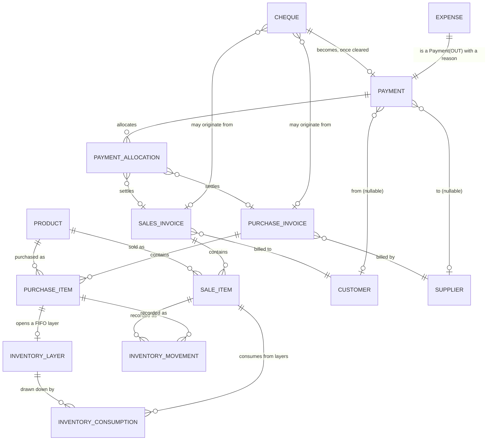
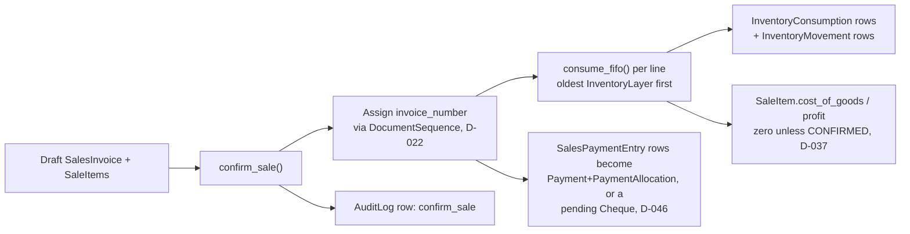

# Architecture — paper-plus

Authoritative overview of how the system is built and why. For exact field
names/types/constraints, regenerate and read `PROJECT_MAP.md`
(`python tools/project_map.py`) — never guess a field name from this file.
For the full rationale behind any rule below, see the referenced decision
in `docs/DECISIONS.md`.

## 1. What it is

A single-business web application for a paper-products trading company:
sales, purchasing, inventory (FIFO costing), payments, cheques,
receivables/payables, expenses, bank accounts, financial reports and
user-activity tracking — cross-linked so every Toman and every unit of
stock traces back to who did what, when, why, and on which document.

Stack: Django 6.1.1, Python 3.13.2, PostgreSQL 18, HTMX + Django templates
(no SPA, no separate API layer). UI language is Persian (`fa`); code,
identifiers and comments are English.

## 2. Apps and responsibilities

| App | Owns |
|---|---|
| `apps.users` | Custom `User` (phone login), no roles — `is_superuser` is the only privilege distinction |
| `apps.products` | `Product` (+ history), selling-price changes |
| `apps.partners` | `Customer`, `Supplier` |
| `apps.purchasing` | `PurchaseInvoice`/`PurchaseItem`, confirm/cancel, Suppliers sub-pages |
| `apps.sales` | `SalesInvoice`/`SaleItem`, confirm/cancel, payment-entry rows |
| `apps.inventory` | `InventoryMovement` (immutable ledger), `InventoryLayer` + `InventoryConsumption` (FIFO cost basis) |
| `apps.payments` | `BankAccount`, `Payment`/`PaymentAllocation`, `Cheque`, `Expense` |
| `apps.shared` | Cross-app selectors (`reports.py`, `dashboard.py`, `user_activity.py`), `AuditLog`, `DocumentSequence`, base templates/JS, admin site |

## 3. Core principles (non-negotiable — see RULES.md)

- **Service layer only.** Views/Admin never write stock or money directly;
  every write goes through `apps/*/services.py` inside `transaction.atomic()`.
- **Append-only ledgers.** `InventoryMovement`, `Payment`,
  `PaymentAllocation`, `Cheque`, confirmed/cancelled invoices, `Expense` are
  never edited or hard-deleted. A mistake is a new, opposite entry
  (D-014, D-023, D-039, D-040).
- **Nothing derived is stored.** `payment_status`, balances, report
  numbers are always computed live from the ledgers, never a field that
  can drift (D-025).
- **Real FIFO costing.** `InventoryLayer` (a batch at a known cost) +
  `InventoryConsumption` (what a sale/cancel drew from which layer) —
  see §5. Replaces the old last-purchase-price approximation (D-036).
- **Full traceability.** Every model recording money or stock carries
  `created_by` and enough FKs to answer who/when/why/which document.
- **Single business, no roles.** `Business`/`BusinessMembership` and the
  Owner/Seller role are deleted (D-033, D-034). Any authenticated user
  can use any page; exactly two actions are `is_superuser`-gated:
  confirming a sale that oversells, and cancelling a confirmed invoice.
- **One-shot invoices.** A sale/purchase (party, items, payment split) is
  created and confirmed atomically in one page submit — no draft-then-
  come-back state exposed to the user.

## 4. Domain model

Full field-level schema: `PROJECT_MAP.md` (generated). Relationships that
matter most — the inventory/costing chain and the money chain:

Key entities not shown above: `AuditLog` (every service call logs one row:
actor, event type, target), `DocumentSequence` (one row per `doc_type`,
issues invoice numbers at confirmation, D-022), `BankAccount` (payments'
and cheques' optional account; `null` = cash).

## 5. Sale confirmation flow (the most complex path)

`cancel_sale`/`cancel_purchase` reverse the exact `InventoryConsumption`
rows they created (not FIFO order — a later sale may have since drawn
from the same layer, D-036) and are rejected once any resulting layer has
already been sold from (purchase cancel only, stricter guard).

## 6. Frontend

Django views + templates, HTMX for partial swaps (live price autofill,
repeating item rows, "record payment" disclosures, quick create of a
customer/supplier/product without leaving the page). No JS framework, no
build step. `/admin/` is a superuser-only technical backend (D-035), not
the user-facing surface — that is the 11 module pages listed in
`docs/REDESIGN_VISION.md` §4.

## Related documentation
- Decisions and full rationale: [DECISIONS.md](DECISIONS.md)
- Process rules and non-negotiables: [RULES.md](RULES.md)
- Current state, what's built, roadmap: [STATE.md](STATE.md)
- Exact live schema: `PROJECT_MAP.md` (regenerate, not committed)
- Rebuild history (Phases A-C, now merged): [REDESIGN_VISION.md](REDESIGN_VISION.md), [MASTER_PROMPT.md](MASTER_PROMPT.md)
